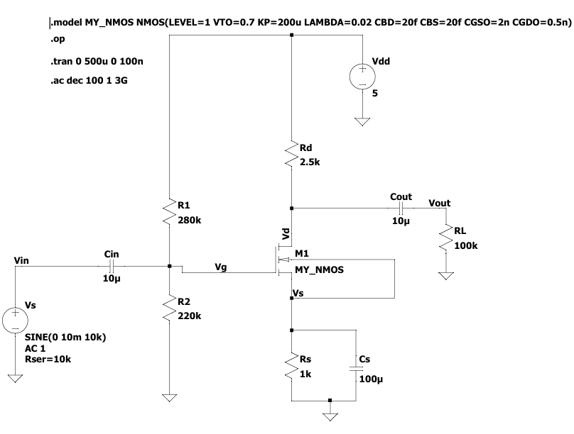
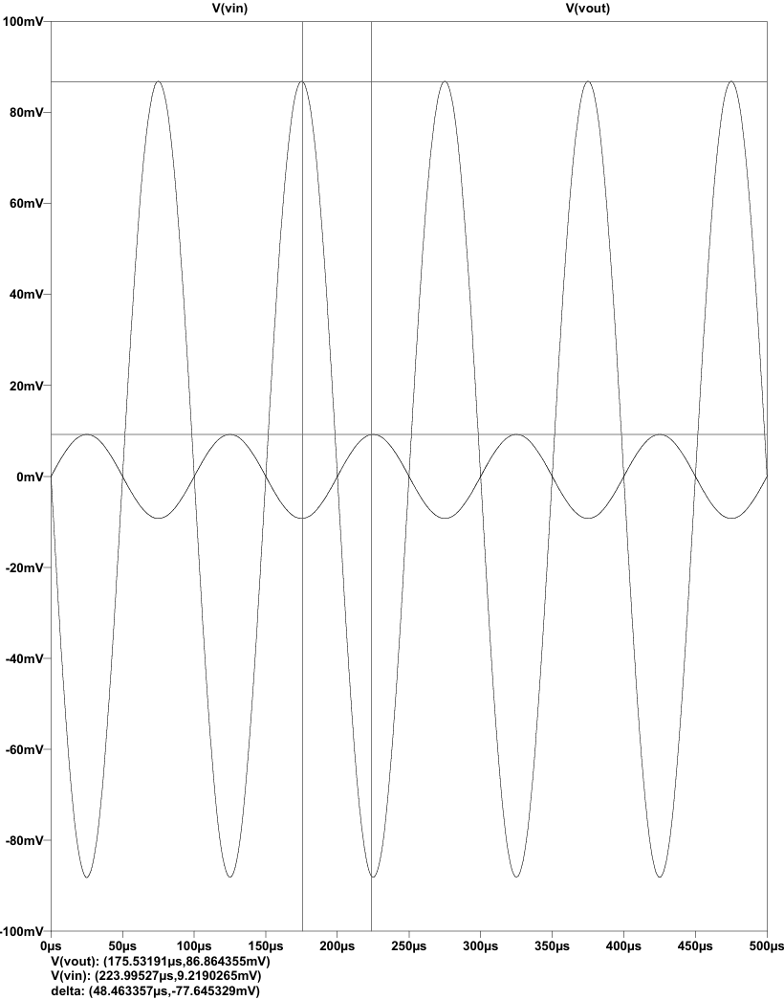
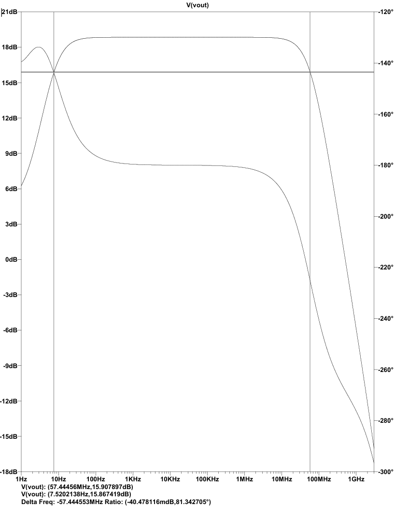

# NMOS Common-Source Amplifier Simulation (LTspice)

## 📌 Project Overview
After learning the theoretical fundamentals of MOSFET biasing and small-signal operation in Analog Electronics, I built this mini-project in **LTspice** to get hands-on experience with schematic capture and SPICE simulations. 

The goal of this project is to design a single-stage **Enhancement-Mode NMOS Common-Source (CS) Amplifier** using voltage-divider and source-resistor biasing, verify its DC operating point (Q-point) against hand calculations, and observe its time-domain amplification and frequency response.

---

## ⚙️ Circuit Topology & Component Values
The amplifier is designed around a $5\text{ V}$ DC supply ($V_{DD}$) to bias the NMOS in the **Saturation Region** at a quiescent drain current ($I_D$) of $1\text{ mA}$.

* **Supply Voltage ($V_{DD}$):** $5\text{ V}$
* **NMOS Model (`MY_NMOS`):** Level 1 MOSFET ($V_{th} = 0.7\text{ V}$, $k_n' = 200\text{ }\mu\text{A/V}^2$, $\lambda = 0.02\text{ V}^{-1}$, $W = 40\text{ }\mu\text{m}$, $L = 1\text{ }\mu\text{m}$)
* **Voltage Divider Bias ($R_1, R_2$):** $R_1 = 280\text{ k}\Omega$, $R_2 = 220\text{ k}\Omega$ (sets $V_G = 2.2\text{ V}$)
* **Drain Resistor ($R_D$):** $2.5\text{ k}\Omega$
* **Source Resistor ($R_S$):** $1\text{ k}\Omega$ (provides DC negative feedback for bias stability)
* **Coupling & Bypass Capacitors:** $C_{in} = 10\text{ }\mu\text{F}$, $C_{out} = 10\text{ }\mu\text{F}$, $C_S = 100\text{ }\mu\text{F}$ (bypasses $R_S$ at AC frequencies to restore voltage gain)
* **Load Resistor ($R_L$):** $100\text{ k}\Omega$

---

## 📊 1. DC Operating Point (`.op`) — Hand Calculations vs. LTspice
To ensure the MOSFET operates as a linear amplifier, it must stay in the saturation region:
1. $V_{GS} > V_{th}$
2. $V_{DS} \ge V_{GS} - V_{th}$ ($V_{ov}$)

| Parameter | Hand Calculation | LTspice `.op` Result | Remarks |
| :--- | :---: | :---: | :--- |
| **Gate Voltage ($V_G$)** | $2.20\text{ V}$ | $2.20\text{ V}$ | Fixed by $R_1$ and $R_2$ potential divider |
| **Source Voltage ($V_S$)** | $1.00\text{ V}$ | $1.006\text{ V}$ | $V_S = I_D \times R_S$ |
| **Drain Voltage ($V_D$)** | $2.50\text{ V}$ | $2.485\text{ V}$ | Centered for good AC output swing |
| **Drain Current ($I_D$)** | $1.00\text{ mA}$ | $1.006\text{ mA}$ | Slight increase due to channel-length modulation ($\lambda$) |
| **Gate-Source Voltage ($V_{GS}$)** | $1.20\text{ V}$ | $1.19\text{ V}$ | $> V_{th} (0.7\text{ V}) \rightarrow$ Channel is ON |
| **Overdrive Voltage ($V_{ov}$)** | $0.50\text{ V}$ | $0.494\text{ V}$ | $V_{ov} = V_{GS} - V_{th}$ |
| **Drain-Source Voltage ($V_{DS}$)** | $1.50\text{ V}$ | $1.48\text{ V}$ | $V_{DS} > V_{ov} \rightarrow$ **Safely in Saturation** |
| **Transconductance ($g_m$)** | $4.00\text{ mA/V}$ | $4.07\text{ mA/V}$ | Extracted from LTspice Error Log |

---

## 📈 2. Simulation Results & Waveforms

### A. Schematic Diagram

### B. Transient Analysis (`.tran`) — Time-Domain Amplification
* **Input Signal (`Vin`):** $10\text{ mV}$ peak sine wave at $10\text{ kHz}$
* **Output Signal (`Vout`):** Amplified sine wave ($\sim 94.8\text{ mV}$ peak) with a **$180^\circ$ phase inversion**, matching the theoretical small-signal gain $A_v = -g_m (R_D \parallel r_o \parallel R_L) \approx -9.48\text{ V/V}$.

### C. AC Sweep Analysis (`.ac`) — Frequency Response (Bode Plot)
* **Midband Gain:** $\sim 19.5\text{ dB}$ ($18.85\text{ dB}$ with a $10\text{ k}\Omega$ source resistance $R_{sig}$)
* **Lower $-3\text{ dB}$ Cutoff ($f_L$):** $7.52\text{ Hz}$ (governed by coupling and source bypass capacitors $C_{in}, C_{out}, C_S$)
* **Upper $-3\text{ dB}$ Cutoff ($f_H$):** $57.44\text{ MHz}$ with $R_{sig} = 10\text{ k}\Omega$

---

## 🧠 Key Learnings
* How to set up custom `.model` SPICE directives and configure 4-terminal MOSFET parameters ($W, L, V_{th}, K_P, \lambda$) in LTspice.
* Why a source resistor ($R_S$) stabilizes the DC bias point and how a parallel bypass capacitor ($C_S$) recovers AC voltage gain.

---

## 🚀 How to Run This Project
1. Download and install [LTspice](https://www.analog.com/en/resources/design-tools-and-calculators/ltspice-simulator.html).
2. Clone this repository and open `NMOS_CS_Amplifier.asc`.
3. Click **Run** to view the simulation results (uncomment `.op`, `.tran`, or `.ac` directives on the schematic depending on which analysis you want to run).
