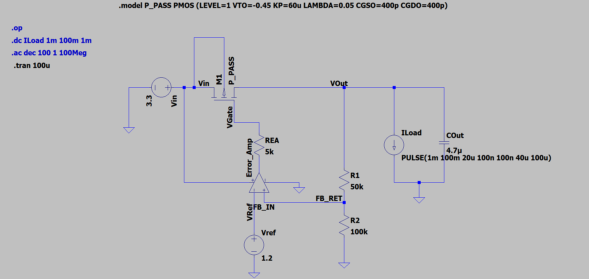
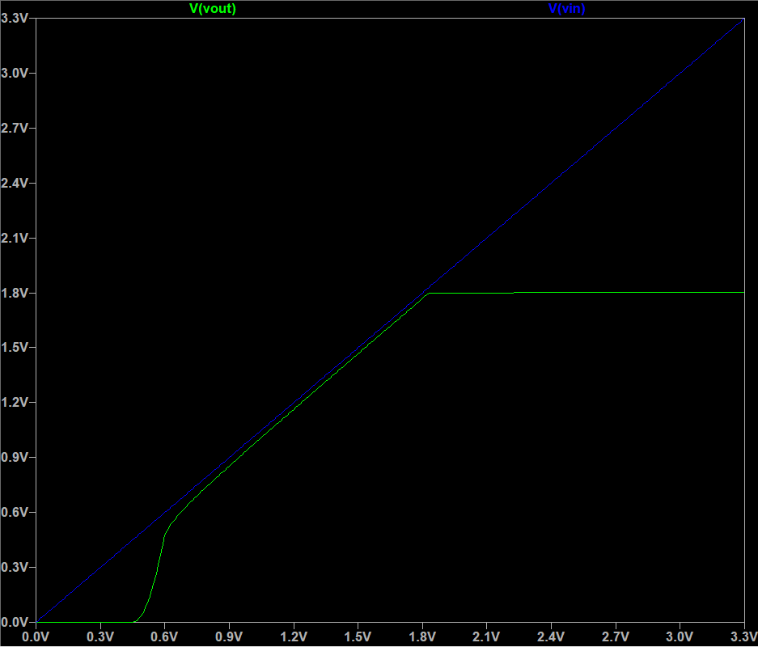
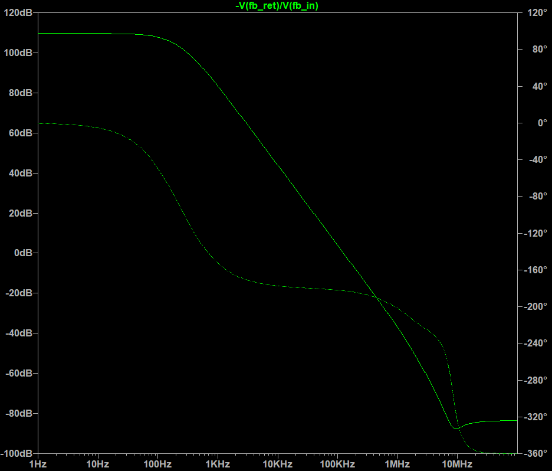
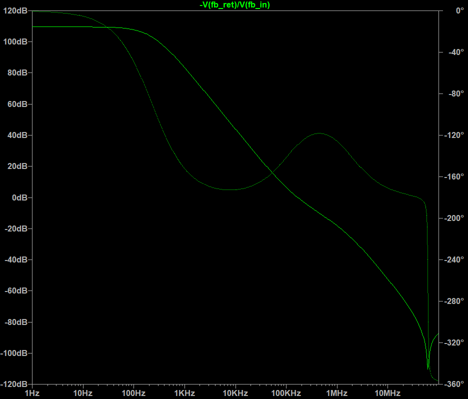
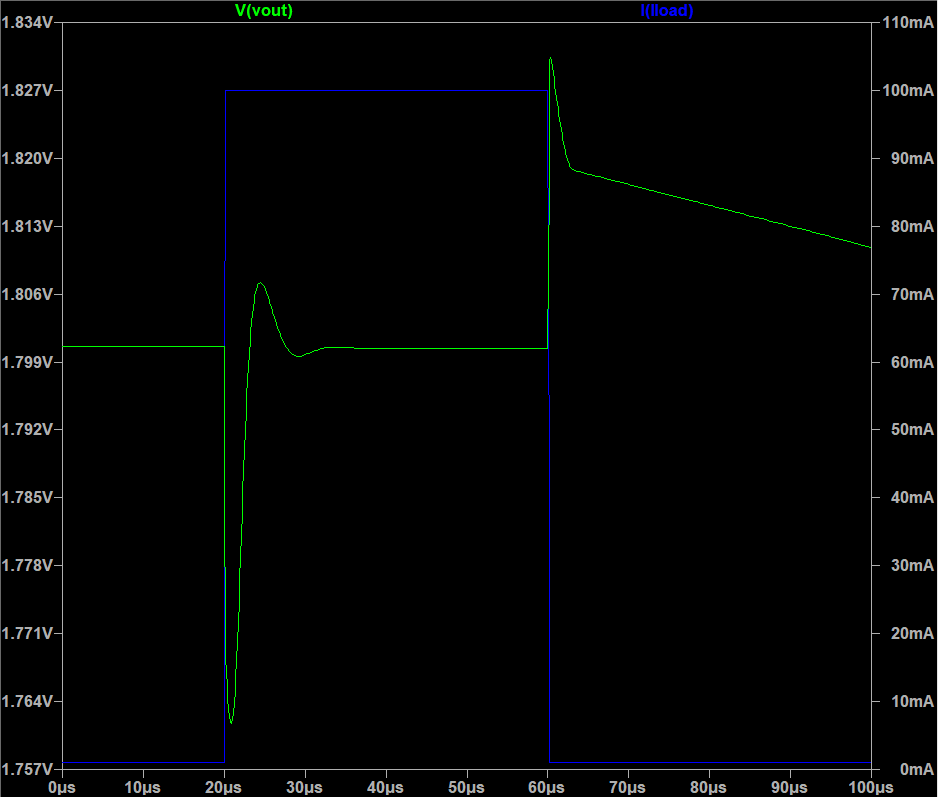

# LTspice Exploration: PMOS LDO Dynamics & Frequency Compensation

### Project Motivation
I built this project to transition my theoretical understanding of Low Dropout (LDO) regulators into practical, visual intuition. While I understand fundamental LDO operation, I wanted to actively explore how control systems, pole-zero interactions, and frequency compensation work in a real circuit simulator before writing a full transistor-level design. 

### The Circuit Setup

I designed a behavioral 3.3V to 1.8V LDO supporting a 100mA maximum load. To focus purely on the control loop dynamics without getting distracted by transistor-level biasing, I used:
* A behavioral Error Amplifier (`GBW = 1MHz`, `Rout = 5kΩ`).
* A custom-sized 180nm PMOS pass transistor (`W/L = 20mm/0.5µm`).
* A standard resistor divider (`50kΩ` and `100kΩ`) setting a 12µA quiescent current.

### 1. DC Analysis: Dropout & Regulation

I verified the basic operational regions of the LDO. The transfer curve clearly shows the PMOS remaining off below the threshold voltage, the dropout region where the output closely tracks the input, and the sharp transition into flat 1.8V regulation.

### 2. AC Stability: The Uncompensated Failure

I ran an AC sweep using a pure 4.7µF ceramic output capacitor (ESR = 3mΩ). The simulation perfectly matched control theory: the parasitic gate capacitance and output pole dragged the phase down to -182.7° at the 125kHz crossover. The loop was entirely unstable with a Phase Margin of -2.7°.

### 3. AC Stability: ESR Zero Compensation

To rescue the loop, I explored Equivalent Series Resistance (ESR) compensation. By increasing the output capacitor's ESR to 300mΩ, the Left-Half-Plane (LHP) zero shifted down to 112kHz. This created a visible phase "bump" right at the 169kHz 0dB crossover, securing a highly stable Phase Margin of 51°.

### 4. Transient Load Step (Time-Domain Proof)

To see how a 51° Phase Margin behaves in the time domain, I stepped the load current from 1mA to 100mA in 100ns. The circuit showed a stable, slightly underdamped recovery with a 38.68mV undershoot, settling back to 1.8V in 16.89µs. This visually confirmed that the frequency compensation successfully prevented sustained ringing.

